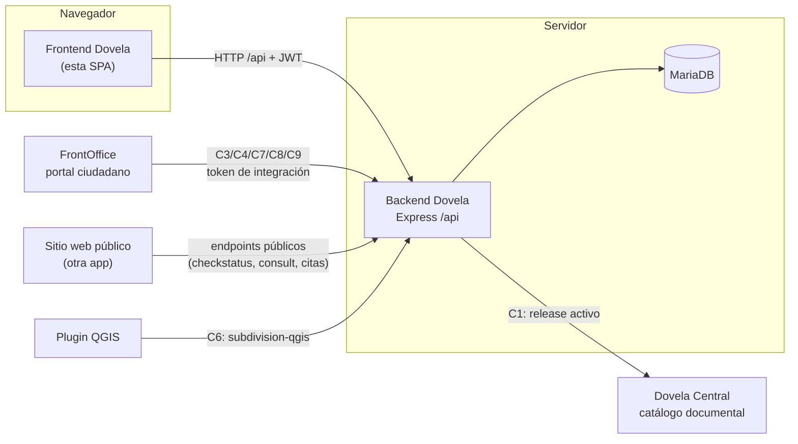
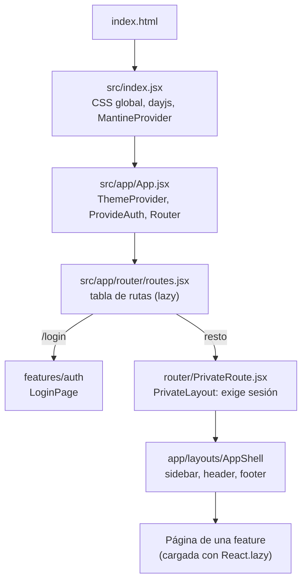
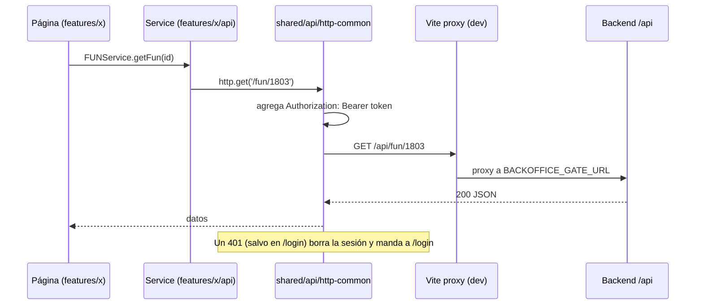
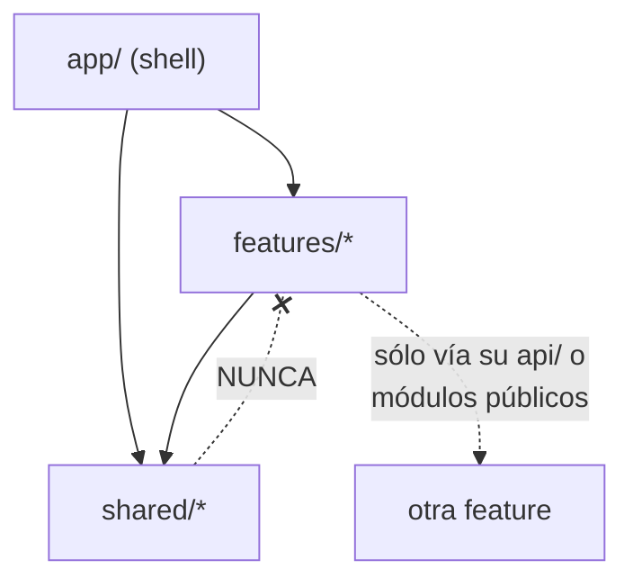
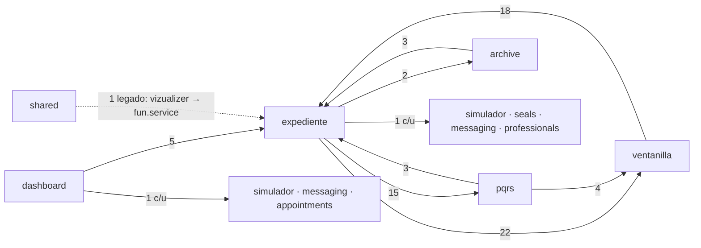

# Arquitectura del frontend Dovela

Guía para ubicarse en el código: qué hace la aplicación, dónde vive cada cosa y cómo se comunica con el backend.

- **Qué es:** la SPA interna (backoffice) que usan las curadurías para gestionar licencias (expedientes FUN), PQRS, ventanilla, archivo, publicaciones y el resto de los trámites.
- **Stack:** React 19 + Vite 6, con React Router 6, Tailwind + shadcn/ui (más Bootstrap legado), axios, i18next, y los editores BlockNote y Jodit.
- **Backend:** [`backend_dovela`](https://github.com/DiegoGomez21/backend_dovela) (ver su `ARCHITECTURE.md`).
- **No es el portal ciudadano:** ese es FrontOffice, un proyecto aparte. El sitio web público también vive fuera de este repo.

---

## 1. El sistema completo



El frontend sólo habla con su backend. Todo lo demás (Central, FrontOffice, sitio público, QGIS) se integra en el backend.

---

## 2. Cómo arranca la aplicación



- **Sesión:** `src/app/router/auth.jsx` (`ProvideAuth`) lee el token y el usuario de `localStorage` (`dovela_token`, `dovela_user`) mediante `shared/api/data.service.js`.
- **Guard:** cualquier ruta privada sin sesión redirige a `/login`. Una ruta desconocida muestra la pantalla 404 a quien tiene sesión y manda a `/login` a quien no la tiene (ver sección 4).
- **Carga diferida:** cada página es un chunk aparte (`React.lazy`). El menú lateral se define en `src/app/layouts/navigation-config.js`, que también precarga los chunks.

---

## 3. Cómo viaja una petición al backend



- **Correlación:** cada petición al backend propio lleva la cabecera `x-dovela-request-id` (`req_<tiempo>_<aleatorio>`), que el backend devuelve y escribe en sus logs. Los clientes de servicios externos no la envían, porque su CORS podría rechazarla.

- **Cliente HTTP:** `shared/api/http-common.js`, creado con `createDovelaHttpClient` de `http-client-factory.js`. Para servicios externos hay clientes aparte: `features/messaging/api/http-emails.js` y `features/professionals/api/http-profs.js`. Esos no envían el token de Dovela.
- **URL base:** `VITE_API_URL`. En local vale `/api`, y Vite reenvía las peticiones a `BACKOFFICE_GATE_URL` (por defecto `http://127.0.0.1:3001`).
- **Contrato:** cada service usa rutas relativas a `/api`. Para comprobar que todas las llamadas del frontend existen en el backend: `node scripts/tools/check-service-route-contract.mjs`, desde el harness.

---

## 4. Errores y observabilidad

El sistema de reporte de errores dentro de la aplicación (la opción de reportar del menú de usuario y las pestañas de reportes en Configuración) se retiró. En su lugar, los errores se registran como logs de trazabilidad en el backend y la interfaz distingue tres casos:

| Caso | Qué ve el usuario | Qué se registra |
|---|---|---|
| **Fatal:** la pantalla no puede mostrarse | Pantalla completa de error, con el estilo del login (`shared/components/errors/ErrorScreen.jsx`) | `ui_crash`, `chunk_load_failed` o `http_error` |
| **Síntoma:** falla una carga, un componente o un cálculo, pero la página sigue mostrando datos | Nada, o un aviso no bloqueante (toast) | `ui_load_failed`, `chart_render_failed`, `js_error`, `unhandled_rejection`, `http_error` |
| **Acción fallida:** guardar, eliminar, generar, validar | El modal de error de siempre (`swalError`) | `ui_action_failed` y el `http_error` de la petición que falló |

### Pantallas de error

| Tipo (`kind`) | Cuándo aparece | Dónde se dispara |
|---|---|---|
| `not-found` (404) | Ruta desconocida con sesión iniciada | `NotFoundRoute` en `app/router/PrivateRoute.jsx`, ruta `*` de `routes.jsx` |
| `crash` (500) | Un componente lanza una excepción al renderizar | `app/router/RouteErrorBoundary.jsx` (envuelve todas las rutas) |
| `chunk` | Falla la carga de un módulo diferido, casi siempre porque se publicó una versión nueva | `RouteErrorBoundary`: recarga una vez sola (con una marca en `sessionStorage` que evita bucles) y, si vuelve a fallar, muestra la pantalla |
| `unavailable` | El backend no responde: error de red sin respuesta, o 502/503/504, en la primera petición de la sesión | `app/layouts/BusinessCalendarBootstrap.jsx`. El botón "Reintentar" repite esa petición. Un *timeout* u otro error conserva el aviso amarillo del calendario |
| `forbidden` (403) | Disponible para páginas que detecten un 403 al cargar: `<ErrorScreen kind="forbidden" />` | Ninguna pantalla lo usa todavía |

Además, el evento `vite:preloadError` (falla la carga de un chunk de Vite) registra `chunk_load_failed` y muestra un aviso "Hay una versión nueva de Dovela" con el botón "Actualizar". No recarga por su cuenta, porque la importación pudo venir de un botón y una recarga inmediata borraría el trabajo sin guardar.

### Cargas fallidas: síntoma solo cuando se marca

`swalError` (`shared/utils/swalAdapter.js`) mantiene el modal bloqueante por defecto. No clasifica por título, texto ni por la última petición fallida: un mismo título ("ERROR AL CARGAR") lo usan también la generación de PDF, las descargas y la asignación de consecutivos, y perder el aviso de una acción es peor que un modal de más.

- **Modal + log `ui_action_failed`** (`warn`, con título, texto, ruta y `relatedRequestId` si se pasa) en cualquier llamada sin `{ symptom: true }`. El usuario ve lo mismo de siempre.
- **Toast + log `ui_load_failed`** solo con `{ symptom: true }`, que se pone únicamente en cargas de fondo verificadas: una lectura (`GET`) que llena datos para mostrar, lanzada al montar o al abrir una pestaña, y sin la cual la página sigue siendo útil. Nunca en generar, descargar, guardar, validar ni asignar consecutivos. Si había un `swalLoading` o un `swalProgressPDF` abierto, se cierra; cualquier otro modal queda abierto.
- Las llamadas que piden una decisión (botones de cancelar o negar, `input`, `preConfirm`) siempre son modal, incluso con `{ symptom: true }`.
- Con `{ error }` o `{ requestId }` el log y el aviso llevan el código de la petición.

### Logger del cliente

`shared/observability/logger.js` expone `logEvent(level, event, fields)`, `logError(event, error, fields)`, `logHttpError(error)`, `newRequestId()` y `getRequestIdFromError(error)`.

- En desarrollo, cada evento también se imprime en la consola.
- Los eventos se agrupan en memoria y se envían a **`POST /api/client-events`** (requiere JWT) cada 5 segundos, al juntar 10, o cuando la pestaña pasa a segundo plano. Sólo se envían si hay sesión.
- Un mismo evento con el mismo mensaje se descarta durante 30 segundos, y cada carga de página envía como máximo 50 eventos. Los datos pasan por la misma redacción de secretos (`redactObject`, `safeText`).
- El envío usa `skipErrorLog: true`: si falla, el lote se descarta y no se registra, para no crear bucles. Si el backend no tiene el endpoint (404/405/501), el logger deja de intentarlo hasta la próxima carga.
- El interceptor de `http-client-factory.js` registra cada petición fallida como `http_error` (`warn` para 4xx y errores de red, `error` para 5xx) con método, ruta sin query, estado y `relatedRequestId`. No registra los 401 (los resuelve el cierre de sesión), las peticiones canceladas ni las que pasan `skipErrorLog: true` porque manejan el error por su cuenta.
- `src/index.jsx` instala los listeners globales de `error` y `unhandledrejection` (sin interfaz) y borra las claves de `localStorage` del sistema de reportes retirado.

### "Código de referencia" y cómo buscarlo en el backend

Las pantallas de error y los avisos de carga muestran un código:

- `req_…`: el `x-dovela-request-id` de la petición que falló. En los logs del backend aparece como `requestId` en la línea `http_error` de esa petición, y como `relatedRequestId` en el `client_event` que la reportó.
- `evt_…`: el `clientEventId` de un evento del cliente, por ejemplo un `ui_crash`. Aparece en la línea `client_event` correspondiente.

El backend escribe una línea JSON por evento, así que basta con buscar el código:

```bash
# Local (Docker)
docker compose logs backend | rg 'req_lz3k9x_a8f2k1m0'
# Producción: el log de Passenger del sitio
rg 'evt_lz3k9x_a8f2k1m0' <ruta-del-log-de-passenger>
```

---

## 5. Estructura de carpetas

```text
src/
├── index.jsx              # punto de entrada: CSS global, providers raíz
├── index.css              # tokens de diseño y overrides (gana sobre Bootstrap)
├── app/                   # SHELL DE LA APLICACIÓN (no contiene negocio)
│   ├── App.jsx            # providers + router
│   ├── router/            # routes.jsx, PrivateRoute, auth (sesión), error boundary
│   └── layouts/           # AppShell, sidebar, header, búsqueda global, navigation-config
├── features/              # UNA CARPETA POR DOMINIO DE NEGOCIO
│   ├── expediente/        # licencias FUN: fun/, documental/, records/, expeditions/, clocks/, api/
│   ├── ventanilla/        # radicación, VR y bandeja de radicación en línea
│   ├── pqrs/  archive/  publications/  nomenclature/  norms/  appointments/ ...
│   └── <feature>/
│       ├── *.jsx          # páginas y componentes de la feature
│       └── api/           # services: las llamadas HTTP de la feature
└── shared/                # LO QUE USAN VARIAS FEATURES
    ├── api/               # cliente HTTP, sesión (data.service), services transversales
    ├── ui/                # componentes shadcn (Button, Dialog, Card…)
    ├── dovela-ui/         # sistema de diseño propio de Dovela
    ├── components/        # componentes genéricos (legacy-modal, icon, tablas, visor…)
    ├── config/            # datos por curaduría (vars, jsons), parsers
    ├── lib/  hooks/  utils/
    ├── i18n/              # traducciones
    ├── styles/            # CSS compartido (legacy-bridge, tema de alertas)
    └── assets/            # imágenes y logos
public/templates/          # plantillas HTML que TemplateEngine carga en tiempo de ejecución (NO mover)
src/__tests__/             # tests de integración y regresión (vitest)
e2e/                       # tests end-to-end (Playwright)
```

### Reglas de dependencia



1. **`shared/` nunca importa de `features/`.** Si algo de una feature lo necesitan varias, se mueve a `shared/`.
2. **Una feature usa a otra sólo a través de su `api/` o de un módulo explícitamente público** (por ejemplo `features/expediente/fun/fun_forms/utils/expedienteWorkspaceRoute`). Hoy existen importaciones profundas heredadas, sobre todo entre `expediente`, `ventanilla` y `pqrs`. No agregues nuevas.
3. **Los services (`api/`) no importan componentes.**
4. **Nombres:** componentes en `PascalCase.jsx`, módulos en `camelCase.js`, services en `<dominio>.service.js`.

---

## 6. Mapa de features

| Feature | URL | Qué hace | Backend (`/api/...`) |
|---|---|---|---|
| `auth` | `/login` | Inicio de sesión | `login`, `me` |
| `dashboard` | `/dashboard` | Panel de control, tarjetas y alertas | conteos vía `fun`, `pqrs_main`, `submit`, `appointments`, `mailbox`, `funmanage/bookmarks` |
| `expediente` | `/licencias`, `/licencias/gestion`, `/licencias/gestion-nueva`, `/funmanage/expediente/:radicado` | Licencias FUN: radicación, gestión, expediente documental, actas (records), expedición, relojes y alarmas | `fun`, `recordarc`, `recordeng`, `recordlaw`, `recordph`, `recordr`, `expedition`, `funmanage/*`, `fun/documentary/v1` |
| `ventanilla` | `/ventanilla` | Ventanilla única, VR y radicación en línea | `submit`, `online-radications` |
| `pqrs` | `/peticiones` | Peticiones, quejas y reclamos | `pqrs_main` |
| `archive` | `/archivo` | Archivo de expedientes | `archive` |
| `publications` | `/publicaciones` | Publicaciones oficiales | `publications` |
| `nomenclature` | `/nomenclatura` | Nomenclatura | `nomenclature` |
| `norms` | `/normas`, `/uso-suelo` | Normas urbanas y uso de suelo | `norms`, `zone_use` |
| `appointments` | `/calendario` | Agenda de citas | `appointments` |
| `business-calendar` | `/calendario-laboral` | Días hábiles y festivos | `business-calendar` |
| `certifications` | `/certificados` | Certificados laborales | `users` |
| `messaging` | `/mensajes` | Buzón y chat interno | `mailbox`, `internal-chat` |
| `settings` | `/configuracion` | Configuración documental, integraciones, personalización | `document-requirements`, `integration-settings` |
| `simulador` | `/simulador`, `/simulador/legal` | Simuladores y guía del flujo jurídico | — (cálculo local) |
| `dictionary` | `/consecutivos` | Consecutivos y diccionarios (VR, CUB, FUN) | `consult` |
| `seals` | `/sellos` | Sellos | `seals`, `generate/seal` |
| `documentos` | `/documentos` | Documentos de apoyo | — |
| `liquidator` | `/calculadora` | Liquidación de expensas | — |
| `professionals` | `/profesionales` | Profesionales (servicio externo) | servicio de profesionales |
| `help` | `/ayuda`, `/dev-guide` | Guía de usuario y de desarrollo | — |

---

## 7. Mapa de dependencias

Generado a partir de los `import` reales con `npm run deps:map`, que además falla si aparece un import roto o si `shared/` empieza a depender de una feature.

Todas las features dependen de `shared/` (unos 1.500 imports), y `app/` las conecta a través del router. Estas son las dependencias **entre features**: cada flecha es "importa de", y el número es la cantidad de imports.



**Cómo leerlo:**
- **`expediente` ↔ `ventanilla` ↔ `pqrs`** es el núcleo acoplado heredado: la radicación crea expedientes y las PQRS se vinculan a ellos. Una feature nueva no debería sumar flechas a ese triángulo; si necesita algo, lo pide a través del `api/` de la otra feature.
- **`dashboard`** depende de varias features porque las resume. Es esperado.
- **La flecha punteada** es la única excepción a "shared nunca importa features": `shared/components/vizualizer.component.jsx` llama a `fun.service`. Está permitida en el script, pero cualquier violación nueva hace fallar `npm run deps:map`.

## 8. Cómo agregar algo nuevo

**Una pantalla nueva dentro de un dominio existente:**
1. Creá el componente en `src/features/<dominio>/`.
2. Si llama al backend, agregá el método en `src/features/<dominio>/api/<dominio>.service.js`, usando `http` de `@/shared/api/http-common`.
3. Si es una página, registrala en `src/app/router/routes.jsx` con `lazy()` y, si va en el menú, en `src/app/layouts/navigation-config.js`.

**Un dominio nuevo:** creá `src/features/<nuevo>/` con su `api/`, y respetá las reglas de dependencia de la sección 5.

**Un componente reutilizable:** si es primitivo de UI, va en `shared/ui` (shadcn) o `shared/dovela-ui`. Si es genérico pero propio de Dovela, en `shared/components`.

---

## 9. Comandos y verificación

| Qué | Comando |
|---|---|
| Desarrollo (puerto 3000, proxy al backend) | `npm run dev` |
| Build de producción | `npm run build` |
| Tests unitarios y de integración | `npx vitest run` |
| Tests end-to-end | `npm run test:e2e` |
| Código sin uso | `npx -y knip@5` |
| Mapa de dependencias | `npm run deps:map` |

Puesta en marcha paso a paso: [`SETUP.md`](SETUP.md). Reglas para agentes y convenciones: [`AGENTS.md`](AGENTS.md).
